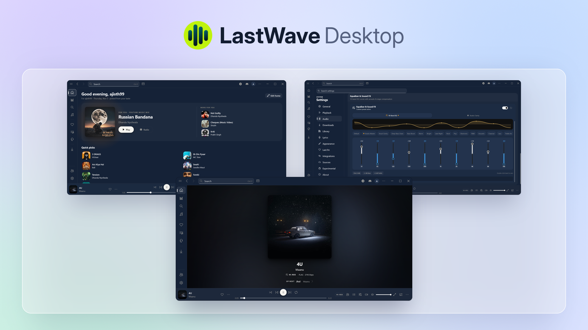

<h1>LastWave</h1>

**Simple Desktop YouTube Music client with WinUI for Windows, Linux & macOS, Bit-Perfect playback, Automix, Lossless addons & advanced audiophile features.**

 

  
  
  

  
  

---

## Overview

LastWave is a next-gen desktop YouTube Music client featuring WinUI styling, Bit-Perfect audio playback, Lossless FLAC addons, smart Automix transitions, real-time synchronized lyrics, and built-in Last.fm scrobbling. It is designed to provide a seamless listening experience with high-fidelity sound and intuitive library management.

---

## Features

- **Audiophile Audio Pipeline:** Bit-Perfect audio output and modular Lossless FLAC playback.
- **Smart Queue & Automix:** Algorithmic smart playlist generation, smooth Automix transitions, and crossfade.
- **Real-Time Synced Lyrics:** Millisecond-accurate synchronized lyrics with romanization support.
- **Last.fm Scrobbler:** Background scrobbling and listening history synchronization.
- **YouTube Music Integration:** Full catalog streaming, playlists, artist discovery, and library management.
- **Cross-Platform:** Native builds available for Windows, Linux, and macOS.

---

## Getting Started

### Installation

1. Download the latest installer for Windows, Linux, or macOS from the [Releases](https://github.com/Clash-Projects/LastWave-Desktop/releases) page.
2. Run the installer and follow the on-screen instructions.
3. Start streaming music, exploring smart radios, and enjoying synced lyrics!

> [!TIP]
> Looking for the Android version? Check out [LastWave Native](https://github.com/Clash-Projects/LastWave-Native).

---

## Disclaimer

LastWave is an open-source, non-commercial application developed strictly for research and educational purposes.

- **No Affiliation:** This project is not affiliated with, funded, authorized, endorsed by, or in any way associated with Google LLC, YouTube, YouTube Music, Spotify, Apple Inc., Last.fm, or any of their subsidiaries.
- **Content Delivery:** LastWave does not host, store on private servers, or distribute copyrighted media. All playback streams and metadata are resolved directly from public endpoints.
- **Trademarks:** All product names, logos, trademarks, and registered trademarks belong to their respective owners.

---

  
Built with ❤️ by <a href="https://github.com/mrinmoyhaloi">Mrinmoy</a>, <a href="https://github.com/SYR3X">Kehan</a> & <a href="https://github.com/ajisth69">Ajisth</a>.

